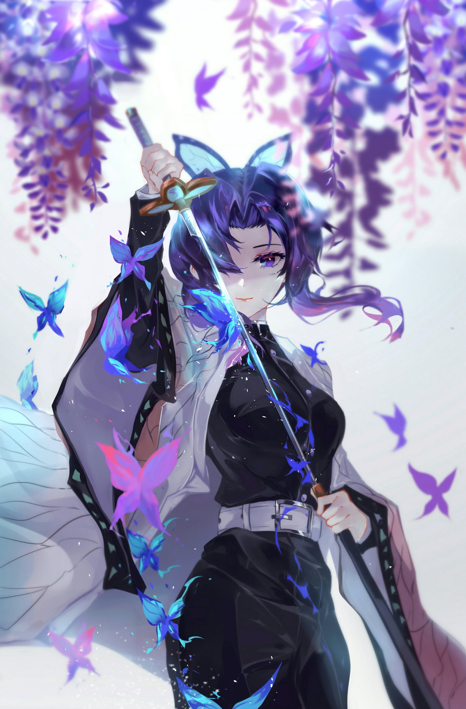

<div align="center">
    
    <a href="https://git.io/typing-svg">
        
    </a>
</div>

## 👋 About Me

Hi there! I'm Christian, a passionate developer who thrives on building full-stack applications. I have a focus on web development and application development, and I'm also interested in the world of machine learning. Welcome to my GitHub profile!

- 🌱 I’m currently learning advanced JavaScript, and machine learning.
- 💬 Ask me about web development, JavaScript, or any tech-related topics.
- 📫 How to reach me: [LinkedIn](https://www.linkedin.com/in/yohanes-christian-devano/) | [Twitter](https://x.com/Nestia27) | [Email](mailto:al.gendon39@gmail.com)


## 💻 Technologies & Tools


### 🖥️ Programming Languages



<div align="left">
    
    
    
    
    
</div>

### 🖼️ Frontend Development

<div align="left">
    
    
    
    
    
</div>

### 🏗️ Backend Development

<div align="left">
    
    
    
    
    
</div>

### 🗄️ Databases & Cloud

<div align="left">
    
    
    
    
    
</div>

### 🛠️ Tools & DevOps

<div align="left">
    
    
    
    
    
    
    
</div>

### 📌 Version Control

<div align="left">
    
</div>


---

## Recent Activity</summary>
_log of my coding activity, open-source contributions, and repository updates:_

<!--START_SECTION:activity-->
1. 💪 Opened PR [#49](https://github.com/NestiaDev-id/My-Web-Portofolio/pull/49) in [NestiaDev-id/My-Web-Portofolio](https://github.com/NestiaDev-id/My-Web-Portofolio)
2. 💪 Opened PR [#48](https://github.com/NestiaDev-id/My-Web-Portofolio/pull/48) in [NestiaDev-id/My-Web-Portofolio](https://github.com/NestiaDev-id/My-Web-Portofolio)
3. 🎉 Merged PR [#47](https://github.com/NestiaDev-id/My-Web-Portofolio/pull/47) in [NestiaDev-id/My-Web-Portofolio](https://github.com/NestiaDev-id/My-Web-Portofolio)
4. 💪 Opened PR [#47](https://github.com/NestiaDev-id/My-Web-Portofolio/pull/47) in [NestiaDev-id/My-Web-Portofolio](https://github.com/NestiaDev-id/My-Web-Portofolio)
5. ❗ Opened issue [#46](https://github.com/NestiaDev-id/My-Web-Portofolio/issues/46) in [NestiaDev-id/My-Web-Portofolio](https://github.com/NestiaDev-id/My-Web-Portofolio)
<!--END_SECTION:activity-->

<br/>

### 📊 My Coding Habits & Productivity

<p> My coding activity isn't limited to a specific time of day. I maintain a consistent development routine, with a natural tendency to work during the evening and late-night hours.</p>

<!--START_SECTION:waka-->
**I'm a Night 🦉** 

```text
🌞 Morning                1276 commits        ██████░░░░░░░░░░░░░░░░░░░   22.96 % 
🌆 Daytime                936 commits         ████░░░░░░░░░░░░░░░░░░░░░   16.84 % 
🌃 Evening                1820 commits        ████████░░░░░░░░░░░░░░░░░   32.75 % 
🌙 Night                  1525 commits        ███████░░░░░░░░░░░░░░░░░░   27.44 % 
```
📅 **I'm Most Productive on Friday** 

```text
Monday                   827 commits         ████░░░░░░░░░░░░░░░░░░░░░   14.88 % 
Tuesday                  638 commits         ███░░░░░░░░░░░░░░░░░░░░░░   11.48 % 
Wednesday                357 commits         ██░░░░░░░░░░░░░░░░░░░░░░░   06.42 % 
Thursday                 931 commits         ████░░░░░░░░░░░░░░░░░░░░░   16.75 % 
Friday                   1128 commits        █████░░░░░░░░░░░░░░░░░░░░   20.30 % 
Saturday                 666 commits         ███░░░░░░░░░░░░░░░░░░░░░░   11.98 % 
Sunday                   1010 commits        █████░░░░░░░░░░░░░░░░░░░░   18.18 % 
```


 Last Updated on 30/10/2026 19:54:05 UTC
<!--END_SECTION:waka-->

</details>


---

## 📊 GitHub Stats

  <!-- Activity Graph -->
<table align="center" style="max-width: 850px; width: 100%;">
  <tr>
    <td colspan="2" align="center">
      <a href="https://github.com">
        
      </a>
    </td>
  </tr>
  
  <!-- Baris Bawah: Dibagi Jadi Dua Kolom Sejajar dan Rapat -->
  <tr>
    <!-- Sisi Kiri: Github Stats -->
    <td align="right" style="vertical-align: top; padding-top: 15px; padding-right: 10px; width: 50%;">
      <a href="https://github.com">
        
      </a>
    </td>
    
<td align="left" style="vertical-align: top; padding-top: 15px; padding-left: 10px; width: 50%;">
      <a href="https://github.com">
        
      </a>
    </td>
  </tr>
</table>


<picture>
  <source media="(prefers-color-scheme: dark)" srcset="https://raw.githubusercontent.com/NestiaDev-id/NestiaDev-id/main/assets/generated/pacman-contribution-graph-dark.svg">
  <source media="(prefers-color-scheme: light)" srcset="https://raw.githubusercontent.com/NestiaDev-id/NestiaDev-id/main/assets/generated/pacman-contribution-graph.svg">
  
</picture>

<picture>
  <source media="(prefers-color-scheme: dark)" srcset="https://raw.githubusercontent.com/NestiaDev-id/NestiaDev-id/main/assets/generated/github-snake-dark.svg">
  <source media="(prefers-color-scheme: light)" srcset="https://raw.githubusercontent.com/NestiaDev-id/NestiaDev-id/main/assets/generated/github-snake.svg">
  
</picture>
